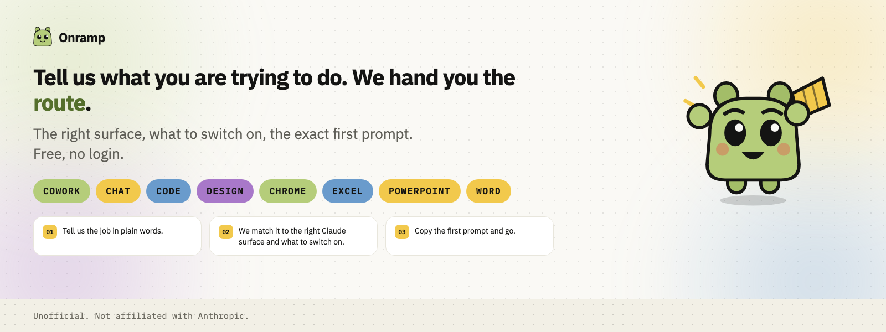
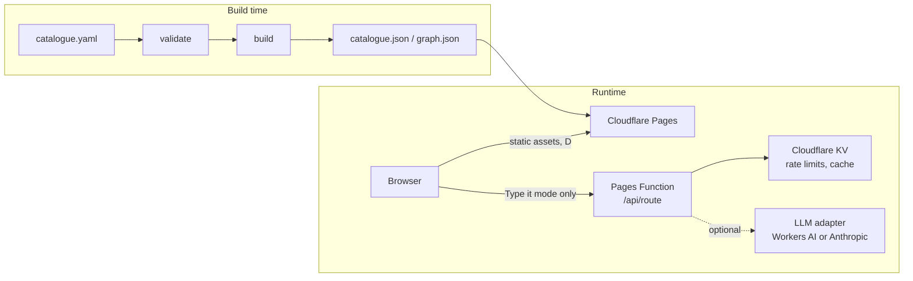

# Onramp

Onramp turns "what are you trying to do?" into a route through Claude: the
right surface to open, what to switch on, and the exact first prompt to
paste. It is free and gets straight to the point.

Onramp is an independent project. It is not affiliated with, endorsed by, or
sponsored by Anthropic. Claude and Anthropic are trademarks of Anthropic,
PBC.

## Architecture

Onramp is a static site plus one small edge function. There is no
traditional database: content is a JSON catalogue built at deploy time, and
a generated route is encoded in its own URL rather than stored anywhere
(see `docs/adr/0002-no-database-route-in-url.md`).



The design source is `docs/design/Onramp.dc.html`, a Claude Design document
(the mascot master is `docs/design/Pip.dc.html`); see `docs/BUILD_CONTRACT.md`
for how its values map onto the design system. Where it conflicts with
`docs/DEVELOPER_BRIEF.md` on behaviour, the brief wins.

Guide me runs the deterministic matcher entirely in the browser against the
data already in the bundle, no network call at all. Type it may call the
edge function, which verifies the request, checks rate limits in KV, runs
the same deterministic matcher, and only calls an LLM to extract intent from
free text when it helps; a failed or disabled LLM call falls back to the
deterministic result (see `docs/adr/0003-deterministic-matcher-llm-optional.md`).

## Run it

Onramp uses pnpm only. Never npm, yarn or bun.

```sh
pnpm --dir app install
pnpm --dir app dev
```

Build and preview the production bundle:

```sh
pnpm --dir app build
pnpm --dir app preview
```

Run the checks locally before opening a PR:

```sh
pnpm --dir app lint
pnpm --dir app typecheck
pnpm --dir app test:unit
pnpm --dir app catalogue:validate
pnpm --dir app test:e2e
pnpm --dir app test:a11y
```

See `app/tests/e2e/README.md` for the end-to-end suite, including the
throttled-4G timing test and how to refresh visual snapshot baselines.

## How routes are built

A route comes from a curated catalogue, not a model guessing on the spot.
The pipeline reads official Claude documentation, builds a knowledge graph
with Graphify, and merges it with a hand-curated `pipeline/catalogue.yaml`
where curated facts always win. A deterministic matcher then scores a
person's goal against that catalogue and assembles the route: surface,
capabilities, connectors, setup steps and a filled prompt template, all
traceable to an official link and an "as of" date. Read
`docs/DEVELOPER_BRIEF.md` for the full pipeline and matching design, and
visit `/how-it-works` on a running instance to watch the real matcher run
against the real catalogue.

## The data promise

Onramp collects aggregate daily counters only: no cookies, no IP storage, no
user text, and no third-party analytics scripts. The exact list of what is
and is not collected is `DATA.md`, published word for word on the app's
`/privacy` page.

## Licence

Copyright (C) 2026 Ayman (aymanxdev).

Onramp's code is licensed AGPL-3.0 (`LICENSE`). The catalogue and generated
data (`pipeline/catalogue.yaml`, `graph.json`, `catalogue.json`,
`changelog.json`) are licensed CC BY 4.0 (`LICENSE-DATA`).

## Governance

The repository owner is the only person who can approve and merge a pull
request; nobody, including the original developer, pushes directly to
`main`. Every contributor signs a lightweight CLA before a contribution can
be merged. All required status checks (lint, typecheck, unit, e2e, a11y,
catalogue validation, link check, no-dashes, bundle size, tokens freshness,
secrets scan, brand guard, OpenSpec validation, licence check, and the CLA
Assistant) must pass, with no bypass for anyone, including admins. See
`CONTRIBUTING.md`, `CODEOWNERS` and `README-GOVERNANCE.md` for the full
detail.
